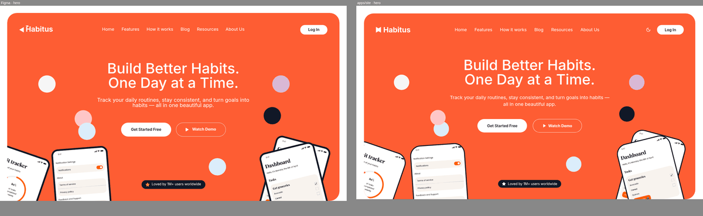
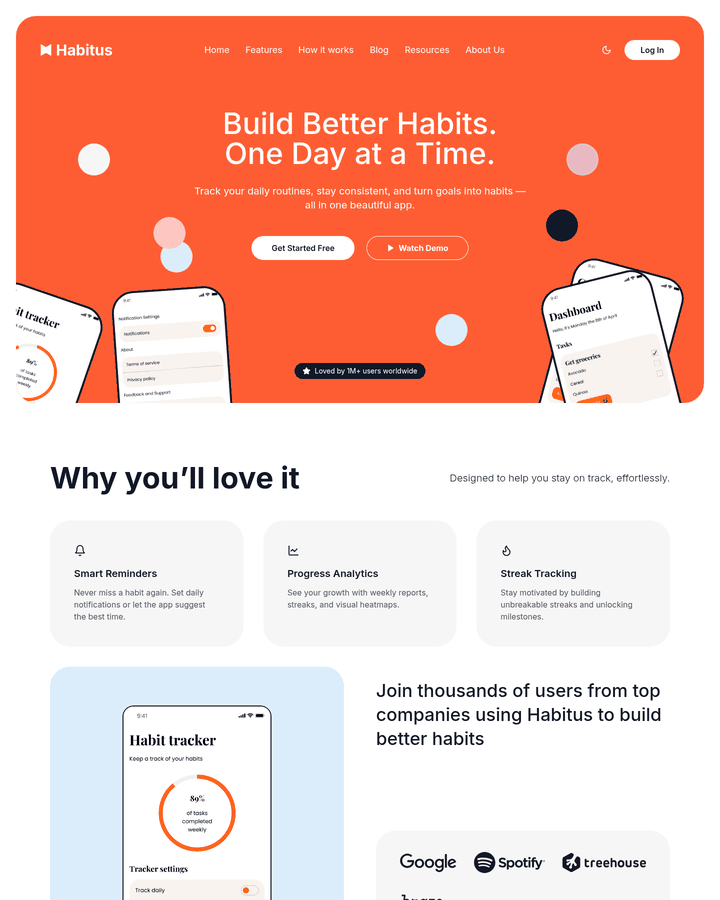
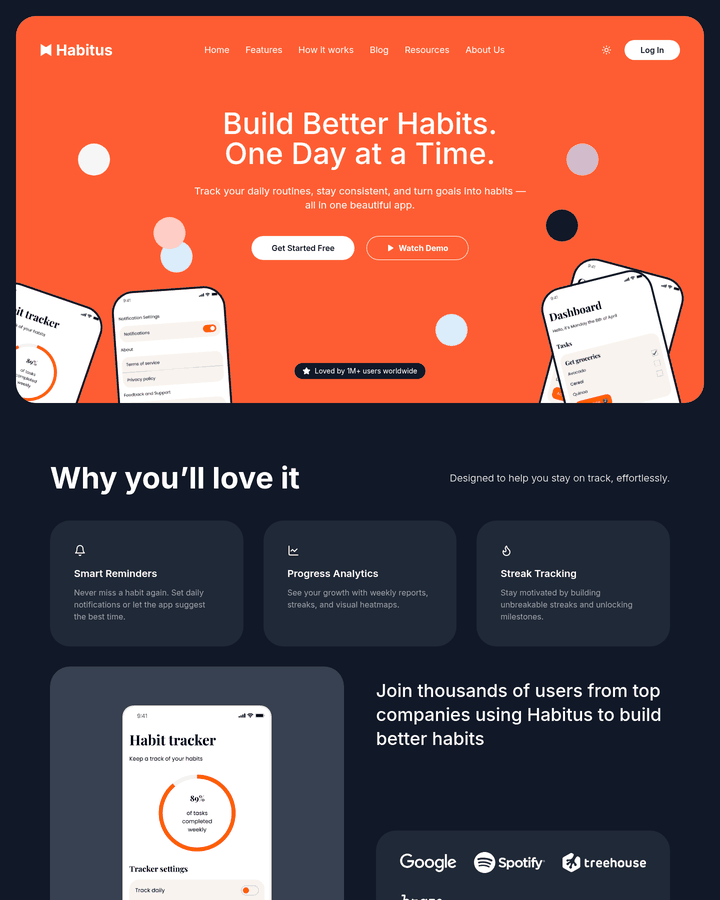
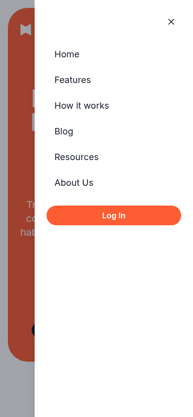
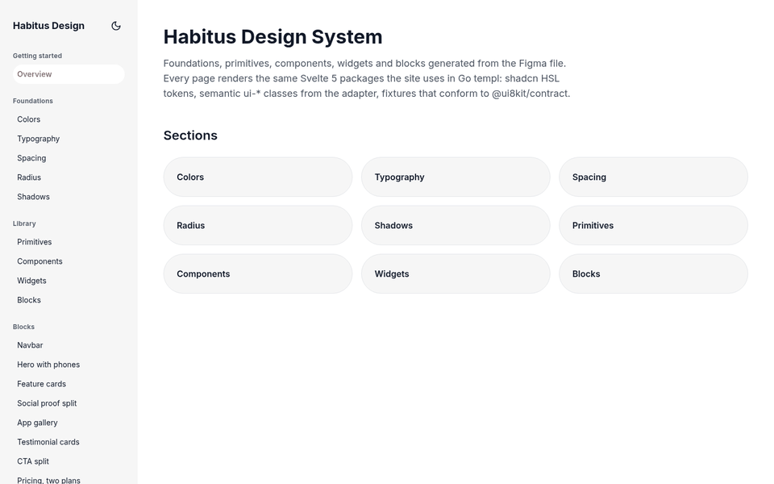
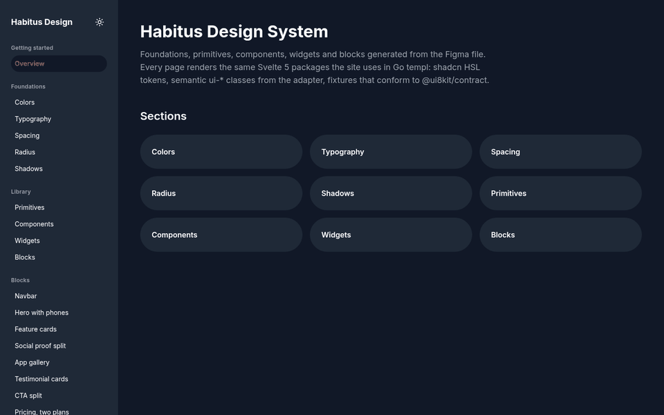
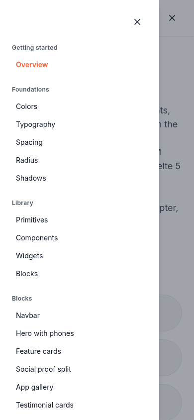
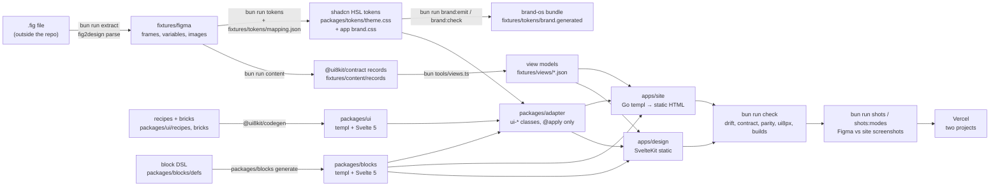

# saas-design — Figma → site + design system, end to end

A **viability check** for a fully generated front-end pipeline. One local Figma file (`.fig`) becomes:

- **`apps/site`**: a static copy of the Figma landing page, rendered with **Go templ** (exported to plain HTML).
- **`apps/design`**: a **Svelte 5 / SvelteKit** design-system app with foundations, primitives, components, widgets and every block.
- Both apps use the **same** tokens, semantic CSS, primitives and blocks. Those come from one source per layer and give **identical DOM/ARIA** in both runtimes, which is checked by parity tests.

Everything between the `.fig` and the deployed apps is a script in this repo or a pinned public tool. `bun run check` fails if any generated file drifts from its source.

> Developers: start with [Quickstart](#quickstart). AI agents: read [AGENTS.md](AGENTS.md) first.

## Screenshots

| Figma (left) vs generated site (right), hero at 1440px |
|---|
|  |

| Site, light | Site, dark | Site, 390px menu (Sheet) |
|---|---|---|
|  |  |  |

| Design app, light | Design app, dark | Design app, 390px nav (Sheet) |
|---|---|---|
|  |  |  |

Full-size screenshots, per-section Figma/site pairs and a `report.json` with height deltas are produced by `bun run shots`. They are written outside the repo, to `/workspace/shots-saas/` (see [docs/checks.md](docs/checks.md#screenshots-not-in-check)).

## Pipeline



Layer details: [docs/architecture.md](docs/architecture.md).

## Tools used

| Tool | Role here | Version used |
|---|---|---|
| [fig2design](https://www.npmjs.com/package/fig2design) ([source](https://github.com/codegen-x/figma-cli)) | Parses `.fig` offline into a JSON dump | `0.1.0` via `npx` |
| [@ui8kit/contract](https://www.npmjs.com/package/@ui8kit/contract) ([source](https://github.com/ui8kit/contract)) | Content record schemas + validator | `0.2.0` (devDependency) |
| [ui8kit/codegen](https://github.com/ui8kit/codegen) (`@ui8kit/codegen`) | Generates primitives from one brick contract into templ, React 19, Svelte 5, Vue 3, SolidJS, Latte or Twig. This repo uses templ and Svelte | `github:ui8kit/codegen#972b492` |
| [ui8px](https://www.npmjs.com/package/ui8px) ([source](https://github.com/ui8kit/ui8px-cli)) | Lints utilities (8+4 grid, token colors, no arbitrary values) | `ui8px@latest` via `npx` |
| [brand-os](https://www.npmjs.com/package/brand-os) ([source](https://github.com/ui8kit/brand-os)) | Brand token contract emit/validate/verify | `0.3.0` via `npx` |
| [templ](https://github.com/a-h/templ) | Go HTML templates | `v0.3.1001`, always via `go run …@v0.3.1001` |
| Tailwind CSS v4 | Compiles `@apply` rules (`source(none)`, no content scanning) | `4` |

## Repository structure

```
.cursor/rules/          agent rules (*.mdc): pipeline, grid, tokens, adapter, blocks, contract, git, dark mode, sheet
.cursor/skills/         figma-to-site skill (agent workflow)
.manual/                short command-by-command manual (00–09)
.project/STATUS.md      deliverable status; .project/backlog/ = one file per tool problem
.ui8px/policy/          generated ui8px lint policy (bun tools/ui8px-policy.ts)
docs/                   English guides (this README links them) + docs/assets screenshots
fixtures/
  figma/                fig2design dump (generated by `bun run extract`)
  tokens/               mapping.json (hand-edited role decisions) → tokens.json, palette.json, brand contract/bundle
  content/source/       authored content that is not in Figma (FAQ answers, showcase data)
  content/records/      @ui8kit/contract records (generated by `bun run content`)
  views/                view models for both runtimes (generated by `bun tools/views.ts`)
  media/                vector assets extracted from the frame
packages/
  tokens/theme.css      shadcn HSL tokens, light + dark, dark variant, layout theme vars (generated)
  adapter/src/          base.css (hand-written) + primitives/blocks *.generated.css: ui-* classes, @apply only
  ui/                   recipes/*.variants.json, bricks/ (local bricks), behaviors/ (vanilla JS), generated templ/ + svelte/
  icons/                lucide subset → templ + Svelte
  blocks/               defs/ (block DSL) → generated templ/ + svelte/ + catalog.json
apps/
  site/                 Go: views/layout.templ, cmd/export (static export), scripts/build.sh, vercel.json
  design/               SvelteKit: src/routes, scripts/foundations.ts + showcase.ts, vercel.json
tools/                  generators, checks, screenshot and measuring scripts (bun/TS, bash)
```

## Quickstart

### Prerequisites

| Tool | Version | Tested here |
|---|---|---|
| Bun | ≥ 1.2 | 1.4.2 |
| Node.js | ≥ 20 (`npx` for fig2design, ui8px, brand-os, Tailwind CLI) | 20.19.2 |
| Go | ≥ 1.23 (`go.mod`) | 1.27.2 |
| templ | v0.3.1001, pinned through `go run`, nothing to install | — |
| Google Chrome | for screenshots and behaviour tests only (`/usr/bin/google-chrome`, or `CHROME=/path`) | — |

### Install and verify

```bash
git clone https://github.com/ui8kit/saas-design && cd saas-design
bun install
bun run check            # must end with "all checks passed"
```

### Extract a Figma file (optional; the dump is committed)

The `.fig` must live **outside** the repo. `tools/extract.sh` refuses a path inside it, and `*.fig` is git-ignored.

```bash
FIG=/absolute/path/outside/repo/file.fig bun run extract
# runs, from /tmp:  npx -y fig2design@0.1.0 parse "$FIG" --out fixtures/figma --no-config
```

The variable is `FIG`; without it the default is `/workspace/fig-fixtures/saas.fig`. Then regenerate and re-check with the pipeline in [AGENTS.md](AGENTS.md#pipeline-order). For a **different** Figma file, follow [docs/replicate-with-new-figma.md](docs/replicate-with-new-figma.md).

### Run the apps

```bash
# site (Go templ → static HTML in apps/site/public)
bun run site:build                         # = bash apps/site/scripts/build.sh
(cd apps/site && bun run serve)            # npx -y serve@14 public -l 4173 → http://localhost:4173

# design system app (SvelteKit)
(cd apps/design && bun run dev)            # vite dev → http://localhost:5173
bun run design:build                       # → apps/design/build (49 prerendered pages)
```

### Other runtimes

`@ui8kit/codegen` also emits React 19, Vue 3, SolidJS, Latte and Twig. This repo only wires templ and Svelte. See [docs/add-a-runtime.md](docs/add-a-runtime.md) for what has to be added; the block emitter is the main piece of work.

## Use it with an AI agent

The repo is written so that an AI coding agent can repeat the result. Point the agent at the repo and ask in plain words. It should read [AGENTS.md](AGENTS.md) first; the guides it needs are [docs/replicate-with-new-figma.md](docs/replicate-with-new-figma.md) (another design) and [docs/add-a-runtime.md](docs/add-a-runtime.md) (another framework).

Example prompts:

- **You like this design but want React / Next.js:**
  > "I want a restaurant website in this same design, on React. Build it in `apps/resta`."
- **You found another great Figma design:**
  > "Study this repo and build me a site and a design system for this design, on Vue. The `.fig` is at `/path/outside/the/repo/design.fig`."
- **Same design, different content:**
  > "Keep this design, but turn the landing page into a fitness-coach site. Change the copy and images through the fixtures, not the components."
- **Another page in the same system:**
  > "Add a pricing page and a blog index to `apps/site`, reusing the existing blocks."

> **Note: this repo has two runtimes, Go templ (`apps/site`) and Svelte 5 (`apps/design`), kept in parity.** If you don't need both, say so up front, e.g. "I want **React only**" (or "Vue only", "Svelte only"). The agent then drops the other runtimes' outputs, apps and checks instead of keeping them in sync. How each request is interpreted: [AGENTS.md → How to interpret common requests](AGENTS.md#how-to-interpret-common-requests).

## Documentation

| Doc | For |
|---|---|
| [AGENTS.md](AGENTS.md) | AI agents: rules, pipeline order, definition of done |
| [docs/architecture.md](docs/architecture.md) | Layers, data flow, why the adapter layer exists |
| [docs/replicate-with-new-figma.md](docs/replicate-with-new-figma.md) | Repeating this with another `.fig` |
| [docs/add-a-runtime.md](docs/add-a-runtime.md) | Adding React, Vue, Solid, Latte/Twig, … |
| [docs/checks.md](docs/checks.md) | Every check, what it verifies, how to fix failures |
| [docs/deploy-vercel.md](docs/deploy-vercel.md) | Two Vercel projects from one repo |
| [docs/troubleshooting.md](docs/troubleshooting.md) | Known gaps and fixes (links into `.project/backlog`) |
| [CONTRIBUTING.md](CONTRIBUTING.md) | Commit rules, how to propose changes |
| [.manual/](.manual/README.md) | Terse command manual |

## Status

See [.project/STATUS.md](.project/STATUS.md). In short:
- All checks are green and parity shows 0 mismatches.
- The site is within 19px of the Figma page height (6269 vs 6288px).
- Dark mode and mobile Sheet navigation work in both apps.
- A real Vercel deploy is **not verified yet**.

## Design credit and license

The source design is **[Habitus — Habit Tracker App Landing Page](https://www.figma.com/community/file/1507106587522840897/habitus-habit-tracker-app-landing-page)** on Figma Community, by [@olgaaverchenko](https://www.figma.com/@olgaaverchenko). All visual design credit goes to them; this repo only re-implements it to test the pipeline. The `.fig` file is not redistributed here.

The design and design-derived assets are licensed under **[CC BY 4.0](https://creativecommons.org/licenses/by/4.0/)**. That covers `fixtures/figma` images/exports, `fixtures/media` artwork, design copy in fixtures, and the `docs/assets` screenshots. The attribution requirements and the full list are in [LICENSE-DESIGN.md](LICENSE-DESIGN.md).

## License

- **Code:** [MIT](LICENSE), © 2026 UI8Kit.
- **Design and design-derived assets:** CC BY 4.0. See [Design credit and license](#design-credit-and-license) and [LICENSE-DESIGN.md](LICENSE-DESIGN.md).
- The upstream tools (fig2design, @ui8kit/contract, ui8kit/codegen, ui8px, brand-os) are MIT-licensed according to their npm metadata.
